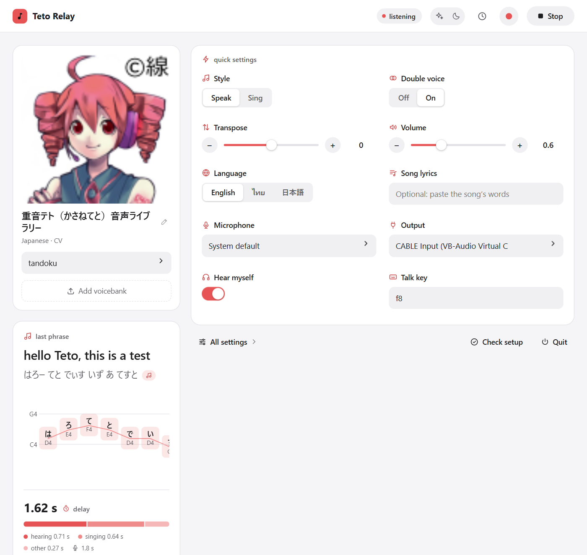
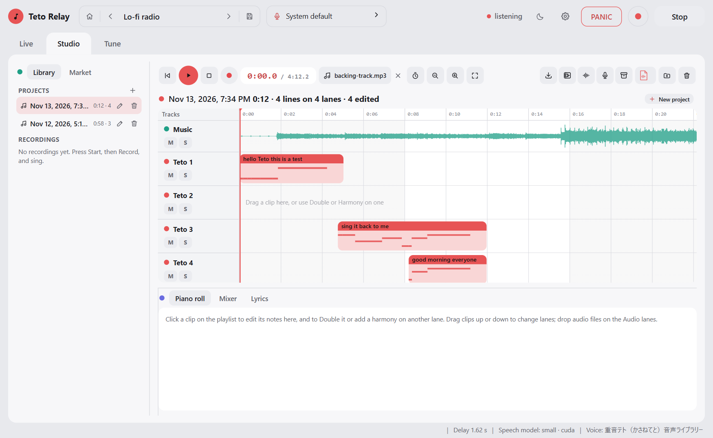
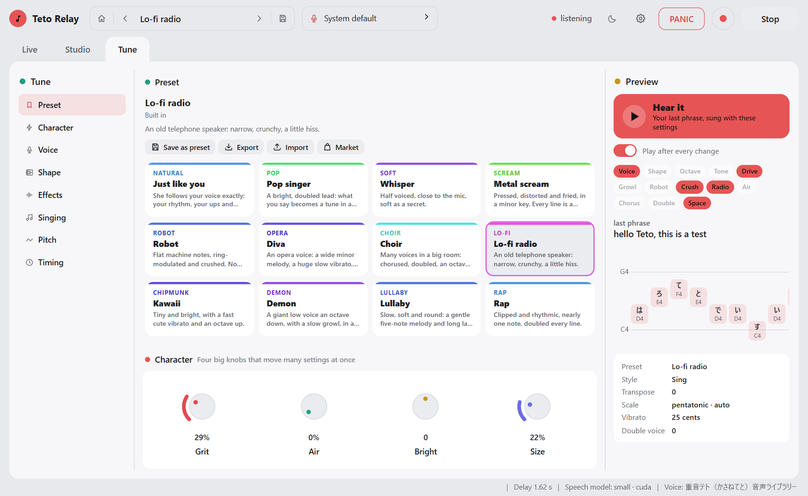

# Teto Relay

**Talk into your mic, and Kasane Teto sings it back.**

Teto Relay hears what you say, works out the words and the melody of your
voice, and sings it back through an UTAU voicebank, live, on your own PC. It
comes out of a virtual audio cable, so Discord, OBS or a game can use her as
your microphone. It speaks English, ไทย and 日本語, and works with any UTAU
voicebank.

Sing a whole song in **Studio**, shape how she sounds in **Tune**, and get or
share tunings, voicebanks and sounds in the **Market**.

*Inspired by [Acrylic](https://www.youtube.com/@hi-im-acrylic)'s video [How I Made A Kasane Teto Voice Changer (kind of...)](https://www.youtube.com/watch?v=z4qr0D6cSmU)
and project [speech-to-text-to-teto](https://github.com/acrylicc/speech-to-text-to-teto).*

> [!WARNING]
> **This is a beta.** It works, and it's fun, but expect rough edges: about
> two seconds of delay, the odd misheard word, and an installer that has only
> been tried on a few PCs. If something breaks, please
> [open an issue](https://github.com/NyanNeaw/teto-relay/issues) and say what you did.

<picture>
  <source media="(prefers-color-scheme: dark)" srcset="docs/images/panel-dark.png">
  
</picture>

## Download

**[⬇ Download the latest version](https://github.com/NyanNeaw/teto-relay/releases)**
(Windows 10 or 11, 64-bit)

- **`TetoRelay-…-setup.exe`** is the installer. Click Next until it's done.
  It gets OpenUtau for you if it's missing, and
  can download the speech models up front so the first start is quick.
- **`TetoRelay-…-portable.zip`** needs no install: unzip anywhere and run
  `TetoRelay.exe`. Everything stays in its `data` folder.

**📖 [Read the how-to-use guide](https://nyanneaw.github.io/teto-relay/how-to-use.html)
before you download.** It shows the whole setup in pictures.

> [!NOTE]
> The installer isn't code-signed yet, so Windows may say *"Windows protected
> your PC"*. Click **More info → Run anyway**.

## What you need

| | |
|---|---|
| **A UTAU voicebank** | Her voice. Kasane Teto's 単独音 (tandoku) bank sounds best; any UTAU bank works. Press **Add voicebank** (or drag it onto the app): a `.zip`, `.rar`, `.7z` or `.uar`, or a folder. |
| **[VB-Cable](https://vb-audio.com/Cable/)** | Only for Discord, OBS and other apps: the virtual cable she sings into. Restart after installing. |
| **OpenUtau** | The installer gets it. With the portable zip, get [OpenUtau](https://github.com/stakira/OpenUtau/releases) yourself and unzip it anywhere. |
| **An NVIDIA graphics card** | Optional. Listening is faster with one. |

Then: open Teto Relay, press **Check setup** in the settings (the gear; it
tells you anything that's missing), pick a voice, set **Output** to
**CABLE Input**, press **Start**, and **hold F8 while you talk**. In Discord
or OBS, choose **CABLE Output** as the microphone.

## How it works

1. **Hold a key and talk** (or sing), then let go.
2. **It listens.** [faster-whisper](https://github.com/SYSTRAN/faster-whisper)
   writes down English and Japanese, and
   [Typhoon ASR](https://huggingface.co/typhoon-ai/typhoon-asr-realtime) Thai,
   with the timing of every word.
3. **It follows your voice.** Your pitch, word by word, becomes her melody,
   moved into her range.
4. **She sings.** The words and notes become an OpenUtau project, and
   OpenUtau's engine sings it in the background, with no window.
5. **Out it goes**, into VB-Cable or your speakers.

Turn on **Hear myself** to hear her in your headphones too. Minimize the
window and a small player stays on top in the corner, with Start, Record,
Hear myself and a hold-to-talk button.

## Studio: whole songs

Press the round **Record** button and sing along to a song (headphones for the
music). No key needed: each pause ends a line. While you record she isn't sent
out as your microphone; turn on Hear myself to hear her.

- **Every line is a clip on a lane**, where you sang it: up to 16 lanes for
  her voice, plus audio lanes for music and sounds. Drag clips to move them.
- **Add your backing track** and record over it. Press **Calibrate** once so
  every line lands on the beat.
- **Click a clip to edit it** in the piano roll underneath, like a small
  OpenUtau: fix a misheard word, drag a note up or down, make it longer or
  shorter, split or join notes. Her tuning follows the notes.
- **Another voice for any part**: **Voice…** sings it again with another
  voicebank or tuning, on its own lane for harmonies.
- **Drag it into FL Studio** or any DAW, or download her singing (.wav), her
  singing over the music (mix.wav), the OpenUtau project (.ustx), or
  everything as a .zip.

<picture>
  <source media="(prefers-color-scheme: dark)" srcset="docs/images/studio-dark.png">
  
</picture>

Singing a real song? Paste its lyrics into the **Lyrics** notepad first, in
any of the three languages, so every word is heard right. Teto Relay follows
along as you sing, even in a long song.

## Tune: how she sounds

Pick a tuning card: **12 are built in**, from *Just like you* to *Metal
scream*, *Robot*, *Diva*, *Choir*, *Lo-fi radio*, *Kawaii*, *Demon* and
*Rap*. Then turn the four **Character** knobs (Grit, Air, Bright, Size), or go
deeper: effects such as drive, growl, radio, chorus and reverb, her tone, and
the shape of every note. **Hear it** sings your last phrase again with the
change. Save your own tuning, or export it as a small `.tetostyle` file to
share.

<picture>
  <source media="(prefers-color-scheme: dark)" srcset="docs/images/tune-dark.png">
  
</picture>

## The Market

Get tunings, voicebanks and sounds that other people made, each with a demo
to play first. Make an account to **Share** your own. A shared voicebank
installs in one click, and a sound drags straight onto a Studio lane. Things
with a price link to the creator's own shop; the Market never takes payment.
Kasane Teto's voicebank is only ever a link to her official site.

## Known issues in this beta

- About **2 seconds** pass between letting go of the key and hearing her.
- Speech recognition sometimes mishears, especially singing. For a real
  song, paste the lyrics into the **Lyrics** notepad first, or fix the word
  afterwards in Studio.
- Market accounts have no email check or password reset yet.
- Japanese voicebanks sing English and Thai as Japanese syllables, which is
  charming but not always clear.
- Windows only.

## Running from the source code

You only need this to work on Teto Relay itself.

```bash
python -m venv .venv
.venv\Scripts\python.exe -m pip install -r requirements.txt
.venv\Scripts\python.exe -m teto_relay --doctor
.venv\Scripts\python.exe -m teto_relay --web
```

`--doctor` lists anything missing, with the fix. `--web` opens the control
panel. For the GPU features (crepe pitch tracking, word alignment), install
torch for your CUDA version, then `requirements-gpu.txt`; the file has the
commands. Other ways to run it:

| Command | What it does |
|---|---|
| `python -m teto_relay` | The relay in the terminal, no panel |
| `pythonw -m teto_relay --tray` | In the system tray |
| `--key ctrl_r`, `--vad` | Another push-to-talk key, or stop on silence instead |
| `--bank tandoku`, `--model small` | Pick the voicebank, or a bigger speech model |
| `--list-banks`, `--list-devices` | Show what it found |
| `--backend null` | Plain tones instead of singing, to test the audio path |

Tests: `.venv\Scripts\python.exe -m unittest discover -s tests` (no audio
hardware, OpenUtau or GPU needed). To build the app, installer and zip, run
`packaging\build.ps1 -WithGpu` in PowerShell (the installer needs Inno Setup 6).

```
teto_relay/          the app: capture, speech-to-text, pitch, notes, rendering, playback
teto_relay/render/   the OpenUtau engine host and the tone-only fallback
teto_relay/web/      the control panel
market-server/       the Market: a Cloudflare Worker (see its README)
packaging/           PyInstaller spec, installer script, build script
docs/                setup guide and the how-to-use page
tests/, tools/       unit tests, and scripts that test one stage at a time
```

More reading: [docs/SETUP.md](docs/SETUP.md) (setup in detail) and
[CHANGELOG.md](CHANGELOG.md).

## License

Teto Relay is free software under the [GNU General Public License v3.0](LICENSE):
you may use, share and change it, and anything you build from it and share
must be under the same license. The libraries and models it uses keep their
own licenses (see Credits).

## Thanks

Huge thanks to **[Acrylic](https://www.youtube.com/@hi-im-acrylic)**: the video
[How I Made A Kasane Teto Voice Changer (kind of...)](https://www.youtube.com/watch?v=z4qr0D6cSmU) is what
started this project, along with their
[speech-to-text-to-teto](https://github.com/acrylicc/speech-to-text-to-teto) project. Go check them out!

## Credits

Teto Relay stands on other people's work, downloaded or bundled as it runs:

- [OpenUtau](https://github.com/stakira/OpenUtau) (MIT) does the singing.
- [faster-whisper](https://github.com/SYSTRAN/faster-whisper) (MIT) and
  OpenAI's Whisper models (MIT) hear English and Japanese.
- Thai speech is heard by [Typhoon ASR Real-time](https://huggingface.co/typhoon-ai/typhoon-asr-realtime)
  by SCB 10X (CC BY 4.0), in PyThaiNLP's ONNX export, run by
  [PyThaiASR](https://github.com/PyThaiNLP/pythaiasr) (Apache-2.0).
- [PyThaiNLP](https://github.com/PyThaiNLP/pythainlp) (Apache-2.0) splits Thai
  words and gives their pronunciation.
- [torchcrepe](https://github.com/maxrmorrison/torchcrepe) (MIT) tracks pitch;
  torchaudio's MMS forced aligner (CC BY-NC 4.0 weights) times words.
- [pykakasi](https://codeberg.org/miurahr/pykakasi) and
  [cmudict](https://github.com/prosegrinder/python-cmudict) (both GPL-3.0)
  read Japanese and English pronunciations.

Kasane Teto and her voicebank belong to their creators. Teto Relay is a fan
project and isn't affiliated with them or with OpenUtau.
