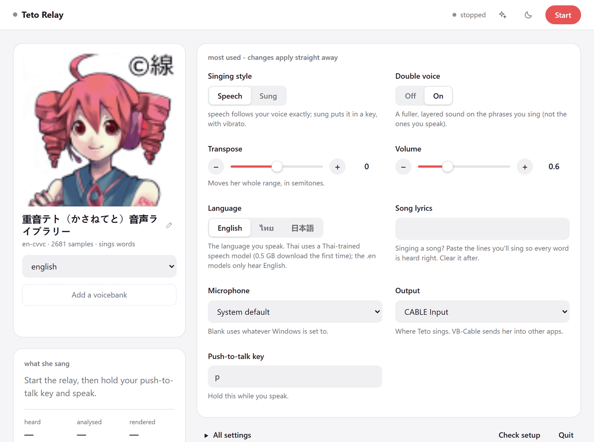

# Teto Relay

**Talk into your mic, and Kasane Teto sings it back.**

Teto Relay hears what you say, works out the words and the melody of your
voice, and sings it back through an UTAU voicebank, live, on your own PC. It
comes out of a virtual audio cable, so Discord, OBS or a game can use her as
your microphone. It speaks English, ไทย and 日本語, and works with any UTAU
voicebank.

> [!WARNING]
> **This is a beta.** It works, and it's fun, but expect rough edges: about
> two seconds of delay, the odd misheard word, and an installer that has only
> been tried on a few PCs. If something breaks, please
> [open an issue](https://github.com/NyanNeaw/teto-relay/issues) and say what you did.

<picture>
  <source media="(prefers-color-scheme: dark)" srcset="docs/images/panel-dark.png">
  
</picture>

## Download

**[⬇ Download the latest version](https://github.com/NyanNeaw/teto-relay/releases)**
(Windows 10 or 11, 64-bit)

- **`TetoRelay-…-setup.exe`** is the installer. Click Next until it's done.
  It gets the .NET 8 runtime and OpenUtau for you if they're missing, and
  can download the speech models up front so the first start is quick.
- **`TetoRelay-…-portable.zip`** needs no install: unzip anywhere and run
  `TetoRelay.exe`. Everything stays in its `data` folder.

**📖 [Read the how-to-use guide](https://nyanneaw.github.io/teto-relay/how-to-use.html)
before you download.** It shows the whole setup in pictures.

> [!NOTE]
> The installer isn't code-signed yet, so Windows may say *"Windows protected
> your PC"*. Click **More info → Run anyway**.

## What you need

| | |
|---|---|
| **A UTAU voicebank** | Her voice. Kasane Teto's 単独音 (tandoku) bank sounds best; any UTAU bank works. Drop its `.zip` into the app. |
| **[VB-Cable](https://vb-audio.com/Cable/)** | Only for Discord, OBS and other apps: the virtual cable she sings into. Restart after installing. |
| **.NET 8 Desktop Runtime** and **OpenUtau** | The installer gets these. With the portable zip, get [.NET 8](https://dotnet.microsoft.com/download/dotnet/8.0) ("Desktop Runtime 8", x64) and [OpenUtau](https://github.com/stakira/OpenUtau/releases) yourself. |
| **An NVIDIA graphics card** | Optional. Listening is faster with one. |

Then: open Teto Relay, press **Check setup** (it tells you anything that's
missing), pick a voice, set **Output** to **CABLE Input**, press **Start**,
and **hold F8 while you talk**. In Discord or OBS, choose **CABLE Output** as
the microphone.

## How it works

1. **Hold a key and talk** (or sing), then let go.
2. **It listens.** [faster-whisper](https://github.com/SYSTRAN/faster-whisper)
   writes down English and Japanese, and
   [Typhoon ASR](https://huggingface.co/typhoon-ai/typhoon-asr-realtime) Thai,
   with the timing of every word.
3. **It follows your voice.** Your pitch, word by word, becomes her melody,
   moved into her range.
4. **She sings.** The words and notes become an OpenUtau project, and
   OpenUtau's engine sings it in the background, with no window.
5. **Out it goes**, into VB-Cable or your speakers.

## Known issues in this beta

- About **2 seconds** pass between letting go of the key and hearing her.
- Speech recognition sometimes mishears, especially singing. For a real
  song, paste the lyrics into **Song lyrics** first.
- Japanese voicebanks sing English and Thai as Japanese syllables, which is
  charming but not always clear.
- Windows only. Microsoft's support for .NET 8 ends in November 2026; moving
  to a newer OpenUtau and .NET is planned.

## Running from the source code

You only need this to work on Teto Relay itself.

```bash
python -m venv .venv
.venv\Scripts\python.exe -m pip install -r requirements.txt
.venv\Scripts\python.exe -m teto_relay --doctor
.venv\Scripts\python.exe -m teto_relay --web
```

`--doctor` lists anything missing, with the fix. `--web` opens the control
panel. For the GPU features (crepe pitch tracking, word alignment), install
torch for your CUDA version, then `requirements-gpu.txt`; the file has the
commands. Other ways to run it:

| Command | What it does |
|---|---|
| `python -m teto_relay` | The relay in the terminal, no panel |
| `pythonw -m teto_relay --tray` | In the system tray |
| `--key ctrl_r`, `--vad` | Another push-to-talk key, or stop on silence instead |
| `--bank tandoku`, `--model small` | Pick the voicebank, or a bigger speech model |
| `--list-banks`, `--list-devices` | Show what it found |
| `--backend null` | Plain tones instead of singing, to test the audio path |

Tests: `.venv\Scripts\python.exe -m unittest discover -s tests` (no audio
hardware, OpenUtau or GPU needed). To build the app, installer and zip, run
`packaging\build.ps1 -WithGpu` in PowerShell (the installer needs Inno Setup 6).

```
teto_relay/          the app: capture, speech-to-text, pitch, notes, rendering, playback
teto_relay/render/   the OpenUtau engine host and the tone-only fallback
teto_relay/web/      the control panel
packaging/           PyInstaller spec, installer script, build script
docs/                setup guide and the how-to-use page
tests/, tools/       unit tests, and scripts that test one stage at a time
```

More reading: [docs/SETUP.md](docs/SETUP.md) (setup in detail) and
[CHANGELOG.md](CHANGELOG.md).

## License

Teto Relay is free software under the [GNU General Public License v3.0](LICENSE):
you may use, share and change it, and anything you build from it and share
must be under the same license. The libraries and models it uses keep their
own licenses (see Credits).

## Credits

Teto Relay stands on other people's work, downloaded or bundled as it runs:

- [OpenUtau](https://github.com/stakira/OpenUtau) (MIT) does the singing.
- [faster-whisper](https://github.com/SYSTRAN/faster-whisper) (MIT) and
  OpenAI's Whisper models (MIT) hear English and Japanese.
- Thai speech is heard by [Typhoon ASR Real-time](https://huggingface.co/typhoon-ai/typhoon-asr-realtime)
  by SCB 10X (CC BY 4.0), in PyThaiNLP's ONNX export, run by
  [PyThaiASR](https://github.com/PyThaiNLP/pythaiasr) (Apache-2.0).
- [PyThaiNLP](https://github.com/PyThaiNLP/pythainlp) (Apache-2.0) splits Thai
  words and gives their pronunciation.
- [torchcrepe](https://github.com/maxrmorrison/torchcrepe) (MIT) tracks pitch;
  torchaudio's MMS forced aligner (CC BY-NC 4.0 weights) times words.
- [pykakasi](https://codeberg.org/miurahr/pykakasi) and
  [cmudict](https://github.com/prosegrinder/python-cmudict) (both GPL-3.0)
  read Japanese and English pronunciations.

Kasane Teto and her voicebank belong to their creators. Teto Relay is a fan
project and isn't affiliated with them or with OpenUtau.
